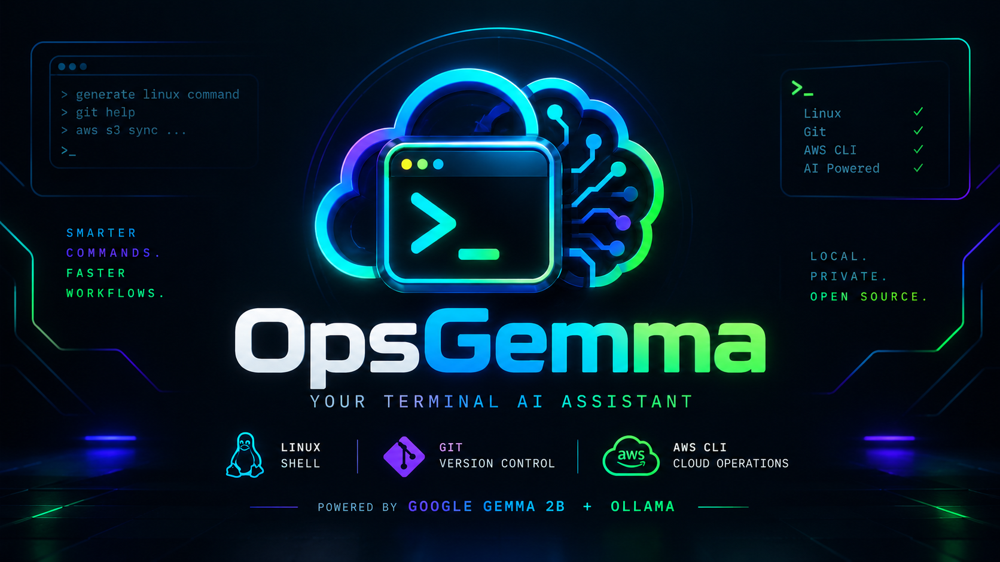

# 🚀 OpsGemma CLI

OpsGemma is a local, privacy-first terminal assistant designed for developers managing Linux systems, Git repositories, and AWS cloud infrastructure. Powered by Google's **Gemma 2 (2B)** running locally via **Ollama**.

## 🛠️ Requirements
- Python 3.8+
- [Ollama](https://ollama.com)
- Gemma 2 Model (`ollama pull gemma2:2b`)

## ⚡ Quickstart
1. Clone this repository:
   ```bash
   git clone [https://github.com/YOUR_GITHUB_USERNAME/opsgemma-cli.git](https://github.com/Philipvin394/opsgemma-cli.git)
   cd opsgemma-cli